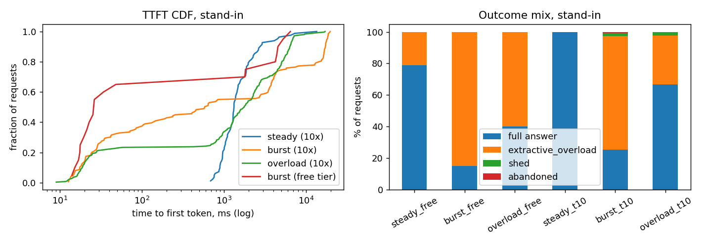

# The Relay

A question-answering service over three papers that gives cited answers, and keeps working when the model provider is slow, failing, or out of quota. Python 3.12, asyncio, plain httpx against Groq's OpenAI-compatible API, my own rate limiter, a FastAPI stand-in for Groq, and a separate load generator.

The papers are Attention Is All You Need (arXiv 1706.03762, v7), Moshi (2410.00037, v1) and the dynamic chunking / H-Net paper (2507.07955, v2). Their SHA-256 hashes are in `papers/MANIFEST.json`.

**Reproducing it.** Run `scripts/fetch_papers.py`, then `scripts/probe_groq.py --hit-limit`, then `scripts/fit_calibration.py`. After that `scripts/run_eval.py` and `scripts/run_load.py` produce the logs. `scripts/make_tables.py` rebuilds every table in this file from `logs/`, and `scripts/build_readme.py` fills them into this document. The tables are not typed by hand. Settings live in `config.yaml` and the seed is 1234. `pytest` runs 13 tests (limiter, citation checker, 429 parsing).

**A note on scope.** The real-Groq numbers are small on purpose because I was on the free tier. Partway through I also hit a daily token limit I didn't know existed (section 2), which used up one model's quota, so some runs had to be repeated on the other model. Every such run is labelled. Runs that turned out to be invalid are still in `logs/`, under names that say what went wrong: `eval_run0_citeparse_bug*`, `eval_tpdexhausted_*`, `eval_suspendartifact_*` and `run1_before_queue_aware/`.

---

## 1. What I built and why

The pipeline is in `relay/pipeline.py`. It has six steps, one tool call, one branch and one loop.

1. **Classify.** The small model (`gpt-oss-20b`) returns the question's intent, a section hint and one or two search queries. Under load a keyword heuristic does this instead.
2. **Retrieve.** BM25 over 1,200-character chunks with 200 characters of overlap, each carrying its page and section. A keyword check picks which paper to search. The search runs in an executor so it can't block the event loop.
3. **Decide.** This is the branch. If few of the query's terms appear in the results (coverage under 0.6), it loops once: the small model rewrites the query and retrieval runs again. If the classifier gave a section hint, it calls the tool `fetch_section(paper, section)` with a 3 s timeout. I inject 5% slow calls and 3% failures into that tool so the failure path actually gets exercised.
4. **Draft.** The large model (`gpt-oss-120b`, or the 20B once the 120B's daily tokens ran out) writes the answer. It must cite as `[C:paper:n]`, and must say "The papers don't say." when the passages don't contain the answer.
5. **Verify.** A cheap deterministic check always runs: there is at least one citation, every cited id was actually retrieved, and every number in the answer appears in a cited chunk. An LLM check runs only when retrieval coverage was low. A failed check gets one regeneration, and after that an honest decline.
6. **Release.** The verified text goes to the user. Streaming from the provider is on, but the user sees nothing until the check has passed.

**What "fast" means here.** For a full model answer I set the target at a median time to first token of 2,500 ms or less and a p95 of 8,000 ms or less. For the no-model fallback the target is under 100 ms. Because the user sees nothing before verification, time to first token for a full answer is roughly the same as total time. That costs little: in the real logs the provider's first and last draft token are about 3 to 4 ms apart (Groq decodes at around 1.4 to 1.8 ms per token). So waiting for verification costs about 4 ms of perceived speed and means an unchecked sentence never reaches the user.

**The decision that shaped the most.** Under pressure the system does less work, or answers from local text. It never swaps in a cheaper, sloppier generated answer. Concretely, when a new request arrives the system estimates how long it would wait, counting everyone already queued. If that wait would eat more than 40% of the user's deadline, it skips the model entirely and quotes the best-matching sentences from the retrieved passages, with citations. If retrieval didn't clearly match the question, it says plainly that it can't answer right now. Requests that already started outrank new ones, since their tokens are already spent. Correctness is the floor, and latency and completeness are what give.

The other tradeoffs, briefly:
- *Fast versus good.* The deterministic check is always on because it costs microseconds. The LLM check only runs on low coverage, which saves about one call per answer. The small model handles classify, rewrite and verify, and the large one writes the draft. The small model turned out not to be faster on Groq (section 2), so its real value is that it draws on a separate quota pool.
- *Good versus cheap.* Top-k is 5 normally and 3 under pressure. The loop is capped at one iteration, because otherwise an unanswerable question burns calls confirming that it's unanswerable.
- *Simple versus many steps.* One loop, one regeneration and one tool call per request, at most.
- *Cheap versus turning nobody away.* Queue first (within the deadline), then the local-text fallback, then shed. Shedding is rare by design, because a cited fallback is more useful than "come back later" and costs no tokens.

## 2. The real service and my stand-in

**Groq's limits as I found them** (free tier, my account; the evidence is in `logs/groq_probe_*.jsonl`):

| limit | value for `gpt-oss-20b` and `gpt-oss-120b` | how I found it |
|---|---|---|
| models | `openai/gpt-oss-20b`, `openai/gpt-oss-120b`, `qwen/qwen3.8-27b`, plus audio and guard models | `GET /models`. I had assumed two Llama models; both returned 404 (log `groq_probe_0_model404_*`) |
| requests per minute | 30 | Only in the body of a 429: "(RPM): Limit 30, Used 30, Requested 1". No header carries it |
| tokens per minute | 8,000 | header `x-ratelimit-limit-tokens` |
| requests per day | 1,000, refilling at 1 per 86.4 s rather than resetting at midnight | header `x-ratelimit-limit-requests`; `reset-requests` read "1m26.4s" |
| tokens per day | 200,000 on the 120B. The 20B never returned a TPD 429 in about 240 calls | Only in a 429 body, which I hit by accident during evaluation: "(TPD): Limit 200000, Used 199538, Requested 1962", with `retry-after: 648` |
| what rejection looks like | HTTP 429, `retry-after: 2` for RPM, 648 s for TPD | a deliberate 40-request burst gave 30 × 200 and 10 × 429 (the first 429 came at request 7 in send order) |

**Real latency** from the probe: short prompts, 15 per model, sequential unless noted.

| probe                       | n   | TTFT p50 ms   | TTFT p95 ms   | TTFT max ms   | total p50 ms   | total p95 ms   |
|:----------------------------|:----|:--------------|:--------------|:--------------|:---------------|:---------------|
| latency:openai/gpt-oss-20b  | 15  | 706.9         | 1678.3        | 1777.6        | 968.1          | 1728.6         |
| latency:openai/gpt-oss-120b | 15  | 420.9         | 736.6         | 836.8         | 517.5          | 801.4          |
| conc4                       | 4   | 534.1         | 627.1         | 639.3         | 593.1          | 702.9          |
| conc8                       | 8   | 1029.9        | 1326.5        | 1434.7        | 1092.5         | 1390.9         |

Percentiles everywhere in this document are `numpy.percentile` with linear interpolation, and each table shows its N.

**The stand-in** (`standin/server.py`) is a FastAPI app that speaks the same `/v1/chat/completions` streaming format, so the pipeline switches between Groq and the stand-in by changing a base URL and nothing else. It models:
- lognormal time to first token per model, and a per-token decode time;
- slowdown that grows with the number of requests in flight;
- occasional slow-but-successful calls (8× time to first token);
- stalls, where it sends a 200 and then goes silent;
- HTTP 500s;
- separate RPM, TPM, RPD and TPD pools per model;
- 429s with `retry-after`, where the kind of limit and its numbers are only in the body, like the real service;
- an `/admin/config` endpoint, so every run records its exact settings (`logs/standin_<tag>.json`).

**Calibration** (`scripts/fit_calibration.py`, output in `data/calibration.json`) comes from the real probe. The 20B's time to first token is lognormal with μ=6.574 and σ=0.740, a median of about 717 ms. The 120B's is μ=6.096 and σ=0.330, a median of about 444 ms. Decode time is 1.81 ms per token for the 20B and 1.39 for the 120B. The concurrency slowdown is 0.0625 per extra in-flight request, fitted from my 4-way and 8-way tests. Limits are as in the table above.

**Where the stand-in is least like the real thing**, most important first:
1. *Behaviour under heavy overload.* The slowdown is a straight line fitted from only 4-way and 8-way tests on one model, and my 10× runs push it to dozens of requests in flight. Read the stand-in's latencies at high concurrency as a shape, not a prediction.
2. *The rare events are invented.* In about 470 real requests (348 pipeline calls plus 126 probe requests) I saw no 5xx, no stall and no slow-but-successful call. So the failure, stall and slow rates are my guesses. The stand-in also charges tokens on an injected 500. I don't know whether Groq does, and if it doesn't, the retry costs in section 8 are overstated.
3. *Groq has its own queue.* Its `queue_time` was 54 to 942 ms in my logs, often more than its compute time of 71 to 248 ms. The stand-in has nothing like that.
4. *My laptop.* The real runs shared a busy machine with the load generator and the server. The loop monitor caught 23 stalls (longest 1,394 ms) in one 4-request real run. The stand-in runs share the same noise, but at its tiny service times it matters less.
5. *Token accounting is a guess.* I inferred that Groq reserves `prompt + max_tokens` up front, because the remaining-token headers fit that better than they fit actual usage. The stand-in copies this, and I haven't confirmed it. The 20B's daily pool is assumed to match the 120B's.
6. *Quality isn't modelled.* The stand-in returns canned text that cites chunk ids it finds in the prompt.

## 3. Results

**Real versus stand-in.** "Real" means the Groq free tier through the full pipeline. "Stand-in" means my service. The real runs are small because 8,000 tokens a minute allows only about 3 full answers a minute (one answer is roughly 2.0 to 2.3k tokens), and 200k tokens a day allows about 85 a day. So the heavy load shapes ran on the stand-in, which is what the brief expected.

The load generator is open-loop, seeded, and a separate process. It has three shapes:
- *steady*: Poisson arrivals below capacity;
- *burst*: a batch of requests within a few seconds, then silence;
- *sustained overload*: Poisson arrivals at several times capacity.

Each simulated user gives up after 20 s, and the server's own deadline is 17 s. I ran each shape at the real free-tier limits and again at 10× those limits (a hypothetical bigger plan), because at free-tier limits even a "steady" run only has a few requests a minute.

Definitions: TTFT is the time from arrival to the first byte of the answer as the client sees it (for full answers this is after verification). Total is arrival to last byte. "Full answers" includes correct "the papers don't say" abstentions. "Quoted-passages fallback" is the no-model reply. "Gave up" means the simulated user left before getting an answer. Percentiles cover the requests that got a first token. Times are in ms and percentages have one decimal. Raw logs are `logs/load_<tag>.jsonl` (client side) and `logs/server_<tag>.jsonl` (pipeline events).

**3a. Real Groq**, with the 20B drafting because the 120B's daily tokens were gone:

| run              | service                 | N   | full answers   | quoted-passages fallback   | turned away (shed)   | declined   | gave up (abandoned)   | errors   | retries   | TTFT p50 ms   | TTFT p95 ms   | Total p50 ms   | Total p95 ms   | gave-up %   | shed %   | tokens/full answer   |
|:-----------------|:------------------------|:----|:---------------|:---------------------------|:---------------------|:-----------|:----------------------|:---------|:----------|:--------------|:--------------|:---------------|:---------------|:------------|:---------|:---------------------|
| steady #1        | REAL Groq (20B drafter) | 4   | 4              | 0                          | 0                    | 0          | 0                     | 0        | 0         | 3737.3        | 8468.9        | 3742.1         | 8579.5         | 0.0         | 0.0      | 2192.8               |
| steady #2        | REAL Groq (20B drafter) | 4   | 4              | 0                          | 0                    | 0          | 0                     | 0        | 0         | 2624.0        | 4890.6        | 2628.8         | 4893.0         | 0.0         | 0.0      | 2193.8               |
| burst (8 in 3 s) | REAL Groq (20B drafter) | 8   | 3              | 4                          | 1                    | 0          | 0                     | 0        | 0         | 967.9         | 3230.0        | 973.2          | 3239.5         | 0.0         | 12.5     | 1876.0               |

**3b. Stand-in at the real free-tier limits** (rpm 30, tpm 8,000, rpd 1,000, tpd 200,000):

| run                          | service   | N   | full answers   | quoted-passages fallback   | turned away (shed)   | declined   | gave up (abandoned)   | errors   | retries   | TTFT p50 ms   | TTFT p95 ms   | Total p50 ms   | Total p95 ms   | gave-up %   | shed %   | tokens/full answer   |
|:-----------------------------|:----------|:----|:---------------|:---------------------------|:---------------------|:-----------|:----------------------|:---------|:----------|:--------------|:--------------|:---------------|:---------------|:------------|:---------|:---------------------|
| steady (0.03 req/s, 600 s)   | stand-in  | 19  | 15             | 4                          | 0                    | 0          | 0                     | 0        | 1         | 1817.4        | 3363.8        | 1981.4         | 3452.4         | 0.0         | 0.0      | 2029.9               |
| burst (20 in 5 s)            | stand-in  | 20  | 3              | 17                         | 0                    | 0          | 0                     | 0        | 0         | 26.2          | 5310.4        | 31.8           | 5314.7         | 0.0         | 0.0      | 2033.0               |
| overload (0.15 req/s, 180 s) | stand-in  | 30  | 12             | 18                         | 0                    | 0          | 0                     | 0        | 0         | 41.2          | 4315.8        | 56.1           | 4319.4         | 0.0         | 0.0      | 1678.8               |

**3c. Stand-in at 10× limits:**

| run                         | service      | N   | full answers   | quoted-passages fallback   | turned away (shed)   | declined   | gave up (abandoned)   | errors   | retries   | TTFT p50 ms   | TTFT p95 ms   | Total p50 ms   | Total p95 ms   | gave-up %   | shed %   | tokens/full answer   |
|:----------------------------|:-------------|:----|:---------------|:---------------------------|:---------------------|:-----------|:----------------------|:---------|:----------|:--------------|:--------------|:---------------|:---------------|:------------|:---------|:---------------------|
| steady (0.3 req/s, 240 s)   | stand-in 10x | 82  | 82             | 0                          | 0                    | 0          | 0                     | 0        | 3         | 1324.5        | 4465.3        | 1328.7         | 4470.7         | 0.0         | 0.0      | 2019.4               |
| burst (150 in 10 s)         | stand-in 10x | 150 | 38             | 108                        | 3                    | 0          | 1                     | 0        | 4         | 585.1         | 18071.7       | 593.1          | 18103.5        | 0.7         | 2.0      | 1940.8               |
| overload (1.0 req/s, 240 s) | stand-in 10x | 248 | 165            | 77                         | 6                    | 0          | 0                     | 0        | 16        | 1762.8        | 6877.6        | 1768.2         | 6882.1         | 0.0         | 2.4      | 1778.9               |

**3d. Answer quality and tokens per answer, on real Groq.** There are 20 easy questions (`data/questions.json`) and 9 hard ones (`data/questions_hard.json`) that I wrote to hit the traps in these papers. Altogether 23 are answerable and 6 are not. The rubric is frozen in `data/RUBRIC.md`: a question scores 1 if the facts are correct and it cites the gold paper and page (±1 page), and 0.5 if the facts are right but the citation is wrong or missing. An unanswerable question scores 1 only if the answer says "the papers don't say" without making a forbidden claim. Tokens per answer counts every model call for that question (classify, draft, and any loop or verify), taken from the API's `usage` field.

One thing to be upfront about: the first run scored 100% on the easy set, so it couldn't tell settings apart. I wrote the hard set after seeing that, and froze it before running any other setting. Then the 120B's daily tokens ran out during the first hard-set comparison. Those four runs are kept as `eval_tpdexhausted_*`, and every hard-set setting was rerun with the 20B drafting (those rows are marked 20B).

| setting                    | drafter      | question set   | n   | quality %   | confident-wrong   | declined   | tokens/answer (API usage, all calls)   | provider draft TTFT p50 ms   |
|:---------------------------|:-------------|:---------------|:----|:------------|:------------------|:-----------|:---------------------------------------|:-----------------------------|
| A bm25 1200/200 k5         | gpt-oss-120b | easy 20        | 20  | 100.0       | 0                 | 0          | 2312                                   | 782.2                        |
| B dense 1200/200 k5        | gpt-oss-120b | easy 20        | 20  | 80.0        | 0                 | 0          | 2278                                   | 793.2                        |
| C dense+rerank 1200/200 k5 | gpt-oss-120b | easy 20        | 20  | 92.5        | 0                 | 0          | 2288                                   | 685.0                        |
| A bm25 1200/200 k5         | gpt-oss-120b | hard 9         | 9   | 72.2        | 0                 | 0          | 2222                                   | 729.1                        |
| A bm25 1200/200 k5         | gpt-oss-20b  | hard 9         | 9   | 83.3        | 0                 | 0          | 2224                                   | 961.6                        |
| B dense 1200/200 k5        | gpt-oss-20b  | hard 9         | 9   | 66.7        | 0                 | 0          | 2174                                   | 1113.2                       |
| C dense+rerank 1200/200 k5 | gpt-oss-20b  | hard 9         | 9   | 77.8        | 0                 | 0          | 2209                                   | 1174.2                       |
| D bm25 600/100 k8          | gpt-oss-20b  | hard 9         | 9   | 61.1        | 0                 | 0          | 1908                                   | 1252.6                       |
| E bm25 2400/300 k3         | gpt-oss-20b  | hard 9         | 9   | 66.7        | 0                 | 0          | 2416                                   | 884.6                        |

Across all 9 evaluation runs there were no confidently wrong answers and no declines. Every failure was a safe one: abstaining when the evidence was weak or badly extracted, or leaving out a citation. With 9 questions per hard-set row, one question is 11 points, so differences of one or two questions are noise. The same setting scored 72.2% on the 120B and 83.3% on the 20B.

**Things I wouldn't have guessed without running it:**
1. Groq has a 200,000 tokens-a-day limit on `gpt-oss-120b` that shows up in no response header, only in a 429 body. At about 2.3k tokens an answer that caps the 120B at roughly 85 answers a day, whatever the 1,000 requests a day in the headers suggests.
2. The 30 requests-a-minute limit is also missing from every header.
3. The "small, fast" model was slower. The 20B's median time to first token was 706.9 ms against 420.9 ms for the 120B, and p95 was 1,678.3 against 736.6 ms.
4. Groq's own `queue_time` (53.3 to 941.8 ms in my real logs) was often larger than its compute time (70.8 to 247.8 ms).
5. A burst of 20 requests at free-tier capacity gets only 3 full answers, because the token bucket holds 7,200 tokens, which is about 3 answers.

**The overload policy, before and after the load test showed it was flawed.** My first version estimated the wait without counting requests already in the queue. In a burst everyone queued up until their deadline and only then got the fallback. On top of that, the server's deadline equalled the user's patience, so some users left just before their answer arrived. Those runs (patience and deadline both 25 s) are kept in `logs/run1_before_queue_aware/`:

| run                               | service      | N   | full answers   | quoted-passages fallback   | turned away (shed)   | declined   | gave up (abandoned)   | errors   | retries   | TTFT p50 ms   | TTFT p95 ms   | Total p50 ms   | Total p95 ms   | gave-up %   | shed %   | tokens/full answer   |
|:----------------------------------|:-------------|:----|:---------------|:---------------------------|:---------------------|:-----------|:----------------------|:---------|:----------|:--------------|:--------------|:---------------|:---------------|:------------|:---------|:---------------------|
| BEFORE fix: burst (20 in 5 s)     | stand-in     | 20  | 3              | 16                         | 1                    | 0          | 0                     | 0        | 0         | 20799.6       | 23261.0       | 20851.6        | 23272.2        | 0.0         | 5.0      | 2033.0               |
| BEFORE fix: overload (0.15 req/s) | stand-in     | 30  | 11             | 10                         | 9                    | 0          | 0                     | 0        | 0         | 1685.7        | 20542.2       | 1691.4         | 20552.8        | 0.0         | 30.0     | 1872.6               |
| BEFORE fix: burst (150 in 10 s)   | stand-in 10x | 150 | 40             | 108                        | 0                    | 0          | 2                     | 0        | 8         | 18906.4       | 23392.3       | 19274.5        | 23485.0        | 1.3         | 0.0      | 2009.7               |
| BEFORE fix: overload (1.0 req/s)  | stand-in 10x | 248 | 153            | 56                         | 24                   | 0          | 15                    | 0        | 21        | 4592.2        | 24246.0       | 4603.0         | 24265.0        | 6.0         | 9.7      | 1980.2               |

After I made the estimate count the queue and gave the server a deadline 3 s inside the user's patience (compare the 3b and 3c rows above), the median first-token time in the free-tier burst dropped from 20,799.6 ms to 26.2 ms. In the 10× overload run, users giving up went from 15 to 0. This isn't a controlled A/B: patience differed (25 s versus 20 s) and the timing differs between seeds. But the direction and size of the effect are clear.

**Did it meet "fast"?** Steady load: yes (at 10×, p50 1,324.5 ms and p95 4,465.3 ms). Sustained overload: yes, p95 was 6,877.6 ms, under the 8 s target. The 150-request burst at 10×: no. Latencies for the fallback replies are fine, but the full answers that were admitted had a p95 time to first token of 13,231.3 ms. The wait estimate is too optimistic for requests that get admitted just under the 40% threshold. I didn't tune it further.

## 4. Where the time goes

The slow request I traced is `real_steady2-0000` (real Groq, 20B). It took 5,217.5 ms to the first byte, the slowest of the 4 in that run. You can reproduce the breakdown with `python scripts/breakdown.py real_steady2`, which also prints the full event timeline. All timestamps come from `perf_counter` on one machine.

| part | ms | how I know |
|---|---:|---|
| before the server saw the request (client to ASGI) | 3,508.8 | client `arrive` versus server `enqueue`. The loop monitor logged stalls of 1,394 and 416 ms inside that window and three more (600, 1,170, 778 ms) in the 3 s before the request arrived. This was the first request of the run, so a cold connection too |
| waiting in my limiter queue | 12.3 | what's left after the other rows; the limiter had capacity (no 429, no queue) |
| provider calls | 1,683.3 | `send` to `last_token`: classify 1,028.6 plus draft 653.8 |
| of which Groq-reported compute / Groq-side queue | 322.0 / 432.4 | API `usage.total_time` 146.4 + 175.6; `usage.queue_time` 378.6 + 53.8 |
| local retrieval | 13.0 | `step_start` and `step_end` for retrieve |
| retrying (backoff) | 0.0 | no `retry` events |

All of the delay came before the first token. The answer is held until the deterministic check passes, so nothing reached the user before `user_first_token` at 5,215.8 ms. The last provider token arrived at 5,215.5 ms, and writing out the reply took about 0.1 ms more. The provider's own first-token events (classify at 1,026.2 ms, draft at 649.6 ms) are earlier and sit inside the provider-calls row. So nearly all of this request's slowness was on my side of the network: a cold first request on a stalled laptop, not the Groq tail.

An earlier real run (`real_steady`, slowest request 9,018.8 ms) had a BM25 search that took 937 ms when it normally takes about 3 ms, which is the same signature. That is why I added the provider-timing and loop-lag instrumentation, and I could only pin the cause down properly in the second run.

## 5. When a limit is hit

**Per-minute limits.** Tokens (8,000 a minute) are the one that binds. Requests (30 a minute) almost never do. The limiter keeps its own token buckets, sized from response headers and from 429 bodies. It learns the RPM limit from a 429 body, since no header has it. When a request arrives, it estimates the wait including everyone ahead of it:
- under 15% of the user's remaining time: normal path;
- under 40%: degraded, meaning the classify call is skipped, top-k goes from 5 to 3, and the loop and LLM verify are skipped. The answer is *delayed* but still comes from the model;
- 40% or more: no model call. If retrieval coverage is at least 0.6, the user gets a *weaker answer* immediately (quoted passages). Otherwise the request is *dropped*, with an honest "I'm at capacity and couldn't find a passage that clearly answers this".

Requests already admitted are never dropped because of load. Continuations run at priority 0 because their tokens are already spent, so an answer that has started will finish.

Who gets what depends on arrival order. Counts per quarter of the burst, earliest first (`results/tables.md`, section C):
- Free-tier burst of 20: the first quarter got 3 full answers and 2 fallbacks, and every later quarter got 5 fallbacks.
- 10× burst of 150: quarter 1 got 29 full answers, 8 fallbacks and 1 gave up; quarter 2 got 9 full and 28 fallbacks; quarters 3 and 4 got 36 fallbacks each (plus 1 and 2 shed).

I chose first-come-first-served among what the budget can pay for, because the alternative (letting everyone queue) made everyone wait and some leave (see the before/after in section 3).

**Per-day limit.** The daily limit that actually binds is tokens (200k), not requests (1,000). The limiter treats both as a daily wall. Once the wall is hit, whether I told it in config or it learned it from the first 429 body, no new model call starts. New arrivals get the quoted-passages reply if retrieval clearly matched, or an honest decline if not. Requests already past classification may still finish. A TPD 429 is never retried inside the deadline (its `retry-after` was 648 s). In the stand-in with a 40,000-token budget (`s_daily_known` and `s_daily_learned`), 20 requests got full answers and then 34 got fallbacks at about 20 to 30 ms median. Learning the limit from the 429 instead of being told cost exactly one request that ran into the wall.

| run                                            | service               | N   | full answers   | quoted-passages fallback   | turned away (shed)   | declined   | gave up (abandoned)   | errors   | retries   | TTFT p50 ms   | TTFT p95 ms   | Total p50 ms   | Total p95 ms   | gave-up %   | shed %   | tokens/full answer   |
|:-----------------------------------------------|:----------------------|:----|:---------------|:---------------------------|:---------------------|:-----------|:----------------------|:---------|:----------|:--------------|:--------------|:---------------|:---------------|:------------|:---------|:---------------------|
| daily budget gone, limiter told                | stand-in 10x, tpd 40k | 54  | 20             | 34                         | 0                    | 0          | 0                     | 0        | 1         | 28.4          | 4506.0        | 36.0           | 4514.9         | 0.0         | 0.0      | 2004.0               |
| daily budget gone, limiter learns from the 429 | stand-in 10x, tpd 40k | 54  | 20             | 34                         | 0                    | 0          | 0                     | 0        | 1         | 22.8          | 2517.0        | 29.9           | 2522.6         | 0.0         | 0.0      | 2004.0               |

## 6. Retrieval: quality versus cost

I tried BM25, dense retrieval (`bge-small-en-v1.5`, with cached embeddings) and dense plus a cross-encoder rerank (`ms-marco-MiniLM-L-6-v2`, pool of 20). I crossed these with chunk size and top-k: 1,200 characters with 5 chunks, 600 with 8, 2,400 with 3, and a degraded 1,200 with 3. There were two measurements. The first is retrieval only: does a chunk from the gold paper and gold page (±1) appear among the retrieved chunks, over the 23 answerable questions, with no model calls. The second is answer quality with the real model (table 3d above).

|                               |   n |   gold page retrieved % |   context chars/answer |   search p50 ms |   search p95 ms | misses                       |
|:------------------------------|----:|------------------------:|-----------------------:|----------------:|----------------:|:-----------------------------|
| A bm25 1200/200 k5            |  23 |                    95.7 |                   5902 |             2.5 |             7.1 | ['h04']                      |
| B dense 1200/200 k5           |  23 |                    91.3 |                   5999 |           195.8 |           846   | ['q07', 'h04']               |
| C dense+rerank 1200/200 k5    |  23 |                   100   |                   5999 |          8254.6 |         17664.9 | []                           |
| D bm25 600/100 k8             |  23 |                    91.3 |                   4780 |             8.1 |            22   | ['q09', 'h04']               |
| E bm25 2400/300 k3            |  23 |                    82.6 |                   7071 |             2.9 |             6.4 | ['q09', 'h04', 'h06', 'h07'] |
| F bm25 1200/200 k3 (degraded) |  23 |                    91.3 |                   3567 |             1.7 |             3.4 | ['h04', 'h07']               |

- **I chose A: BM25, 1,200-character chunks, 200 overlap, top-k 5.** It finds the gold page 95.7% of the time at a median search time of 2.5 ms. The reranker reaches 100%, but its median search takes 8,254.6 ms (on CPU, in an executor, and cross-paper questions search twice). That is several times the length of the whole model call and would break the latency target on its own.
- Dense retrieval was slower (195.8 ms) and worse, both at finding the gold page (91.3%) and on end-to-end quality: 80.0% versus 100% on the easy set, and 66.7% versus 83.3% on the hard set. Its misses were false abstentions, which is the safe way to fail.
- Smaller chunks (D) lost context and scored 61.1% on the hard set. Bigger chunks with k=3 (E) hurt retrieval (82.6%), because three 2,400-character chunks were often the wrong three.
- I don't report user-visible time to first token per setting. The evaluation used a 300 s deadline so questions would queue behind the token limit, which makes each one take about 21 s. That is a pacing artefact and not a latency. What I can report is the provider's draft time to first token, p50 685.0 to 1,252.6 ms across rows in table 3d, and the local search latency in the table above.
- **Near a limit,** top-k drops from 5 to 3 (setting F: gold page found 91.3% instead of 95.7%, context 3,567 characters instead of 5,902, roughly 40% fewer prompt tokens, search 1.7 ms). The query-rewrite loop and classify call are skipped. If no model call is allowed at all, the answer is built from the highest-overlap sentences of the top 3 chunks.

## 7. Where this library fools a naive retriever

1. **Tables and numbers come out of the PDF scrambled.** "How many parameters does the big Transformer model have?" has the answer (213M) only in the last row of Table 3. It was answered correctly in 1 of 6 runs. The others abstained or got it wrong, and the abstentions are the safe failure. "How many layers and what model dimension does Moshi's Depth Transformer use?" (6 layers, 1,024) lives in a table whose cell labels are separated from their values. Gold-page retrieval missed it in every setting except the reranker, and answers were half right (0.5) when the model did find it. Only the 2,400-character setting, which keeps a whole table row together with its header, got the first question.
2. **The same words show up in all three papers.** "Transformer", "attention", "heads" and "layers" appear everywhere (Moshi has a Temporal and a Depth Transformer; H-Net compares against Transformer baselines). For "How many attention heads does the base Transformer use?", BM25's top hits were the appendix "Attention Visualizations" (score 15.64) and the ablation table. The architecture page with `h = 8` (p.5) wasn't in its top 3, though dense retrieval ranked it first. My keyword-based paper filter and top-k 5 fix this case, but a plain top-3 would answer from the wrong place.
3. **Structure heuristics lie, and my own filter removed real text.** My heading detector labelled 11 chunks of the H-Net paper "2.95 Perplexity on HG38", which is a table row. It also labelled pages 24 to 31 "References", so the filter that drops references removed 26 of the 146 H-Net chunks, including the start of Appendix A (Related Work, p.31). A question like "What does Appendix A of the dynamic chunking paper say about related work?" would have part of its evidence deleted from the index. I didn't test that exact question, but you can check the exclusion in `data/chunks_1200_200.json`. Page numbers are the dependable citation anchor (the PDF page index matches the printed numbers in these three papers). Section names are not.

Two other questions sound answerable from memory but aren't: "How many TPUs were used to train the Transformer base model?" (the word never appears in any of the three papers; the paper says 8 P100 GPUs) and "English-to-Czech BLEU". They test the abstain path, and the clean runs handled them correctly.

## 8. Retries

**The policy** is in `relay/llm.py`:
- at most 3 attempts, with exponential backoff (base 0.5 s, cap 8 s) and full jitter, never shorter than a `retry-after` the server sent;
- no retry if the wait wouldn't fit in the request's remaining deadline;
- no retry of a daily-limit 429, which switches to the daily path instead. Only per-minute 429s, 5xx and timeouts are retried;
- a retry budget, so retries stay at or below 20% of first attempts over a rolling 30 s window and an incident can't multiply the load;
- a per-call timeout of min(12 s, remaining deadline), so a call that sends headers and then stalls gets cut and retried or replaced by the fallback;
- a failed verification triggers one regeneration, counted separately.

**A case where retrying made things worse.** In the stand-in with 30% injected failures, load at 110% of capacity and 113 identical arrivals per run (`s_retrysat_*`):

| run                           | service                    | N   | full answers   | quoted-passages fallback   | turned away (shed)   | declined   | gave up (abandoned)   | errors   | retries   | TTFT p50 ms   | TTFT p95 ms   | Total p50 ms   | Total p95 ms   | gave-up %   | shed %   | tokens/full answer   |
|:------------------------------|:---------------------------|:----|:---------------|:---------------------------|:---------------------|:-----------|:----------------------|:---------|:----------|:--------------|:--------------|:---------------|:---------------|:------------|:---------|:---------------------|
| 0.4 req/s, no retries         | stand-in 10x, 30% failures | 82  | 55             | 27                         | 0                    | 0          | 0                     | 0        | 0         | 817.8         | 2815.3        | 824.3          | 2820.6         | 0.0         | 0.0      | 1681.8               |
| 0.4 req/s, budgeted retries   | stand-in 10x, 30% failures | 82  | 64             | 18                         | 0                    | 0          | 0                     | 0        | 29        | 1155.9        | 4111.4        | 1164.1         | 4116.0         | 0.0         | 0.0      | 1827.3               |
| 0.4 req/s, unbounded retries  | stand-in 10x, 30% failures | 82  | 72             | 10                         | 0                    | 0          | 0                     | 0        | 84        | 2459.1        | 6522.7        | 2465.5         | 6527.7         | 0.0         | 0.0      | 1945.2               |
| 0.55 req/s, no retries        | stand-in 10x, 30% failures | 113 | 77             | 36                         | 0                    | 0          | 0                     | 0        | 0         | 1138.4        | 4037.5        | 1142.8         | 4166.4         | 0.0         | 0.0      | 1704.8               |
| 0.55 req/s, budgeted retries  | stand-in 10x, 30% failures | 113 | 75             | 38                         | 0                    | 0          | 0                     | 0        | 40        | 1456.5        | 6269.2        | 1459.1         | 6271.9         | 0.0         | 0.0      | 1860.5               |
| 0.55 req/s, unbounded retries | stand-in 10x, 30% failures | 113 | 81             | 32                         | 0                    | 0          | 0                     | 0        | 100       | 2022.1        | 8530.1        | 2023.6         | 8531.9         | 0.0         | 0.0      | 1943.3               |

| run                  | provider calls sent   | retries   | tokens reserved (est)   | tokens in successful calls (API usage)   |
|:---------------------|:----------------------|:----------|:------------------------|:-----------------------------------------|
| s_retrysat_none      | 228                   | 0         | 285255                  | 134729                                   |
| s_retrysat_budget    | 261                   | 40        | 361836                  | 142981                                   |
| s_retrysat_unbounded | 277                   | 100       | 411873                  | 158526                                   |

Unbounded retries (3 attempts, no budget) sent 277 provider calls for 113 users, against 228 with no retries, and reserved 411,873 tokens against 285,255 (44.4% more). In return they completed 4 more full answers (81 versus 77), while p95 time to first token more than doubled (8,530.1 ms versus 4,037.5 ms; p50 2,022.1 versus 1,138.4 ms). The 20% budget cost less but at this load still didn't help: 75 full answers, 2 fewer than no retries, with p95 at 6,269.2 ms.

At 80% load (the rows above, 0.4 req/s) the picture is different. Retries raised full answers from 55 to 64 to 72 out of 82 but tripled median time to first token (817.8 to 2,459.1 ms). That is a genuine tradeoff and not a loss. One caveat: the stand-in charges tokens on injected failures. If the real service doesn't, the token cost is overstated (the latency effect isn't). No retries happened in the real runs (about 470 requests, no 5xx). The one real retry decision I saw was declining to retry a 648-second TPD `retry-after`.

## 9. What the person sees

At 3 pm the daily budget is gone. A waiting person gets this reply in about 20 to 30 ms (median 22.8 to 28.4 ms over all requests in the two stand-in daily runs, and 16.2 to 19.2 ms for the fallback replies alone). It's the actual text from the daily-budget run, taken from the `answer` field of a `done` event with status `extractive_daily`:

> *Our language-model budget for today is used up, so I can't write a summary right now. Here are the most relevant passages from the papers, quoted verbatim:*
> *"On the WMT 2014 English-to-French translation task, our model establishes a new single-model state-of-the-art BLEU score of 41.8 after training for 3.5 days on eight GPUs, a small fraction of the training costs of the best models from the literature." [C:attention:1]*
> *"6 Results 6.1 Machine Translation On the WMT 2014 English-to-German translation task, the big transformer model (Transformer (big) in Table 2) outperforms the best previously reported models (including ensembles) by more than 2.0 BLEU, establishing a new state-of-the-art BLEU score of 28.4." [C:attention:22]* (a third passage follows)

If retrieval didn't clearly match the question, they get this instead: *"Today's model budget is used up and I couldn't find a passage that clearly answers this. Please try again tomorrow."* Requests that were already past their first model call when the budget ran out are allowed to finish normally.

Two weaknesses I know about. The quoted passages are only as relevant as BM25's coverage score lets them be; in `s_daily_learned` one reply quoted a figure caption. And the message says "tomorrow" when the real limit is a rolling window (a 1,962-token request was told to wait 648 s), so "try again in a few minutes" would be more accurate. I left both as they are.

## 10. What I'm unsure about, what I left out, what I learned

**My least certain assumption** is that the stand-in's behaviour under high concurrency, and its injected failures, represent the real service. The slowdown is a straight line through two measured points (4-way and 8-way), and the failure and stall rates are guesses, since I saw no real failure in about 470 requests. If that's wrong, the 10× latency tails and every retry-cost number in section 8 would move. The policy conclusions (count the queue when shedding, never retry a daily 429) don't depend on it, but the size of the "retries made it worse" effect does. A close second is the assumption that Groq charges `prompt + max_tokens` up front. If it charges actual usage instead, my limiter leaves roughly a quarter of the quota unused.

**Two things I chose not to build:**
1. *The Gemini fallback.* It's configured (`providers.gemini`) but I never ran or measured it. Groq stayed usable once I changed models, and a second provider would bring a second set of unknown limits to be unsure about.
2. *Request hedging for slow calls* (sending a duplicate after the p95 time and taking whichever answers first). On a clean service it would help the tail, but on a quota this tight it burns tokens, which is the same failure section 8 shows for unbounded retries. I also didn't build a persistent or multi-process limiter, since the service is single-node by design.

**Something new I learned:** TODO(Vaatsalya): write this yourself, in your own words. Candidates from this build, but pick whatever was actually new to you: (a) a provider's limits can be invisible in the headers, and a limit you only learn from an error body can change your whole budget; (b) estimating queue wait without counting the queue makes overload worse, since everyone waits and then gets the weak answer anyway; (c) a latency number is only as honest as the machine that ran the load generator, which is why I added the loop-lag monitor.

## 11. Feedback on Vaani

TODO(Vaatsalya): visit vaani.dev and write 3 to 5 honest lines yourself: what stood out, what confused you, one thing you'd change. I haven't visited it and have deliberately not drafted anything here.

## 12. How I worked with the assistant

**(a) The real conversation history.** The raw, uncleaned transcript of this session is Claude Code's local log, `C:\Users\vaats\.claude\projects\c--VSCode-VaaniAI\3d1234a4-10af-4d96-9f81-ce7e7066d0dd.jsonl`. It is JSONL and holds every prompt, tool call and result. TODO(Vaatsalya): copy it into `docs/` yourself, and skim it first, because it contains tool output from your machine (for example your Groq organization id appears in the 429 bodies in `logs/`). Your own prompts, in order, were: the brief PDF, "Choose the groq models urself…", "done", "Continue", and then the follow-ups. If you can't export it, paste those prompts here instead.

**(b) Half a page on the three prompts that mattered most, one thing the assistant got wrong that I caught, and one decision I overruled.** TODO(Vaatsalya): this has to be your account, not the assistant's. Material you can draw on, all of it in the logs: it assumed two Llama models that returned 404 (caught by `GET /models`; see `logs/groq_probe_0_model404_*`). It parsed citations in ASCII brackets only, so the first quality run declined 12 of 20 questions (`logs/eval_run0_citeparse_bug*`). Its first overload policy made burst users wait 20 s for a weaker answer (`logs/run1_before_queue_aware/`). And it wrote the hard-question file through a shell heredoc that silently halved the backslashes, which crashed four runs. Which of these you caught, and any decision you overruled, is for you to say.

**(c) What in this submission is distinctly mine.** TODO(Vaatsalya): for example your choice of models and of the Gemini key as a secondary, your instruction to protect the quota during testing, your decision to carry on after the daily-token wall, and your own reading of vaani.dev. I haven't written this for you.
