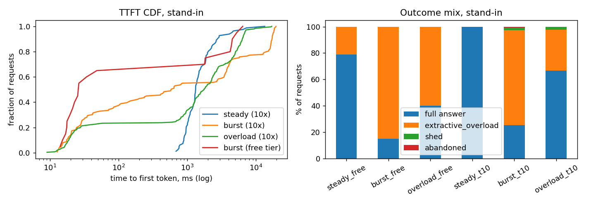

# The Relay

A question-answering service over three papers that gives cited answers, and keeps working when the model provider is slow, failing, or out of quota. Python 3.12, asyncio, plain httpx against Groq's OpenAI-compatible API, my own rate limiter, a FastAPI stand-in for Groq, and a separate load generator.

The papers are Attention Is All You Need (arXiv 1706.03762, v7), Moshi (2410.00037, v1) and the dynamic chunking / H-Net paper (2507.07955, v2). Their SHA-256 hashes are in `papers/MANIFEST.json`.

**Reproducing it.** Run `scripts/fetch_papers.py`, then `scripts/probe_groq.py --hit-limit`, then `scripts/fit_calibration.py`. After that `scripts/run_eval.py` and `scripts/run_load.py` produce the logs. `scripts/make_tables.py` rebuilds every table in this file from `logs/`, and `scripts/build_readme.py` fills them into this document. The tables are not typed by hand. Settings live in `config.yaml` and the seed is 1234. `pytest` runs 30 tests (limiter, citation checker, 429 parsing, cache, failover routing, table rebuild). `python scripts/check.py` runs the tests, a free retrieval-quality guard and the tables-match-logs check in about 30 seconds; add `--standin` or `--real` for a burst on the stand-in or five real questions (about 11k Groq tokens). Adding a fourth paper is described in `docs/ADD_A_PAPER.md`.

**Two rounds.** Sections 1 to 12 are the first round, written when the first set of experiments was done. A second round fixed the weaknesses that round named; it is described in the appendix after section 12, and the places where it changes something above are marked "(round 2: ...)".

**A note on scope.** The real-Groq numbers are small on purpose because I was on the free tier. Partway through I also hit a daily token limit I didn't know existed (section 2), which used up one model's quota, so some runs had to be repeated on the other model. Every such run is labelled. Runs that turned out to be invalid are still in `logs/`, under names that say what went wrong: `eval_run0_citeparse_bug*`, `eval_tpdexhausted_*`, `eval_suspendartifact_*` and `run1_before_queue_aware/` from round 1, and `eval_invalid_coldstart_*`, `eval_invalid_calltimeout12s_*`, `*r2_invalid_suspendartifact*` and `gemini_probe_0_model404_*` from round 2.

---

## 1. What I built and why

The pipeline is in `relay/pipeline.py`. It has six steps, one tool call, one branch and one loop.

1. **Classify.** The small model (`gpt-oss-20b`) returns the question's intent, a section hint and one or two search queries. Under load a keyword heuristic does this instead.
2. **Retrieve.** BM25 over 1,200-character chunks with 200 characters of overlap, each carrying its page and section. A keyword check picks which paper to search. (Round 2: the chunker was fixed, and a table's rows, rebuilt from the page layout, are attached when the table is on a retrieved page and shares most of the question's words; see appendix B.) The search runs in an executor so it can't block the event loop.
3. **Decide.** This is the branch. If few of the query's terms appear in the results (coverage under 0.6), it loops once: the small model rewrites the query and retrieval runs again. If the classifier gave a section hint, it calls the tool `fetch_section(paper, section)` with a 3 s timeout. I inject 5% slow calls and 3% failures into that tool so the failure path actually gets exercised.
4. **Draft.** The large model (`gpt-oss-120b`, or the 20B once the 120B's daily tokens ran out; in round 2, optionally Gemini when Groq's daily budget is gone) writes the answer. It must cite as `[C:paper:n]`, and must say "The papers don't say." when the passages don't contain the answer.
5. **Verify.** A cheap deterministic check always runs: there is at least one citation, every cited id was actually retrieved, and every number in the answer appears in a cited chunk. An LLM check runs only when retrieval coverage was low. A failed check gets one regeneration, and after that an honest decline.
6. **Release.** The verified text goes to the user. Streaming from the provider is on, but the user sees nothing until the check has passed.

**What "fast" means here.** For a full model answer I set the target at a median time to first token of 2,500 ms or less and a p95 of 8,000 ms or less. For the no-model fallback the target is under 100 ms. Because the user sees nothing before verification, time to first token for a full answer is roughly the same as total time. That costs little: in the real logs the provider's first and last draft token are about 3 to 4 ms apart (Groq decodes at around 1.4 to 1.8 ms per token). So waiting for verification costs about 4 ms of perceived speed and means an unchecked sentence never reaches the user.

**The decision that shaped the most.** Under pressure the system does less work, or answers from local text. It never swaps in a cheaper, sloppier generated answer. Concretely, when a new request arrives the system estimates how long it would wait, counting everyone already queued. If that wait would eat more than 40% of the user's deadline, it skips the model entirely and quotes the best-matching sentences from the retrieved passages, with citations. If retrieval didn't clearly match the question, it says plainly that it can't answer right now. Requests that already started outrank new ones, since their tokens are already spent. (Round 2: the estimate also counts the draft calls that already-admitted requests have not sent yet; round 1 missed those.) Correctness is the floor, and latency and completeness are what give.

The other tradeoffs, briefly:
- *Fast versus good.* The deterministic check is always on because it costs microseconds. The LLM check only runs on low coverage, which saves about one call per answer. The small model handles classify, rewrite and verify, and the large one writes the draft. The small model turned out not to be faster on Groq (section 2), so its real value is that it draws on a separate quota pool.
- *Good versus cheap.* Top-k is 5 normally and 3 under pressure. The loop is capped at one iteration, because otherwise an unanswerable question burns calls confirming that it's unanswerable.
- *Simple versus many steps.* One loop, one regeneration and one tool call per request, at most.
- *Cheap versus turning nobody away.* Queue first (within the deadline), then the local-text fallback, then shed. Shedding is rare by design, because a cited fallback is more useful than "come back later" and costs no tokens.

## 2. The real service and my stand-in

**Groq's limits as I found them** (free tier, my account; the evidence is in `logs/groq_probe_*.jsonl`):

| limit | value for `gpt-oss-20b` and `gpt-oss-120b` | how I found it |
|---|---|---|
| models | `openai/gpt-oss-20b`, `openai/gpt-oss-120b`, `qwen/qwen3.8-27b`, plus audio and guard models | `GET /models`. I had assumed two Llama models; both returned 404 (log `groq_probe_0_model404_*`) |
| requests per minute | 30 | Only in the body of a 429: "(RPM): Limit 30, Used 30, Requested 1". No header carries it |
| tokens per minute | 8,000 | header `x-ratelimit-limit-tokens` |
| requests per day | 1,000, refilling at 1 per 86.4 s rather than resetting at midnight | header `x-ratelimit-limit-requests`; `reset-requests` read "1m26.4s" |
| tokens per day | 200,000 on the 120B. The 20B never returned a TPD 429 in about 240 calls in round 1, nor in round 2 after about 300,000 tokens within 24 hours (summed from the logs, small-model calls from the 120B runs included), so its daily limit is higher; I never found it | Only in a 429 body, which I hit by accident during evaluation: "(TPD): Limit 200000, Used 199538, Requested 1962", with `retry-after: 648` |
| what rejection looks like | HTTP 429, `retry-after: 2` for RPM, 648 s for TPD | a deliberate 40-request burst gave 30 × 200 and 10 × 429 (the first 429 came at request 7 in send order) |

**Real latency** from the probe: short prompts, 15 per model, sequential unless noted.

{{snip_probe}}

Percentiles everywhere in this document are `numpy.percentile` with linear interpolation, and each table shows its N.

**The stand-in** (`standin/server.py`) is a FastAPI app that speaks the same `/v1/chat/completions` streaming format, so the pipeline switches between Groq and the stand-in by changing a base URL and nothing else. It models:
- lognormal time to first token per model, and a per-token decode time;
- slowdown that grows with the number of requests in flight;
- occasional slow-but-successful calls (8× time to first token);
- stalls, where it sends a 200 and then goes silent;
- HTTP 500s;
- separate RPM, TPM, RPD and TPD pools per model;
- 429s with `retry-after`, where the kind of limit and its numbers are only in the body, like the real service;
- an `/admin/config` endpoint, so every run records its exact settings (`logs/standin_<tag>.json`).

**Calibration** (`scripts/fit_calibration.py`, output in `data/calibration.json`) comes from the real probe. The 20B's time to first token is lognormal with μ=6.574 and σ=0.740, a median of about 717 ms. The 120B's is μ=6.096 and σ=0.330, a median of about 444 ms. Decode time is 1.81 ms per token for the 20B and 1.39 for the 120B. The concurrency slowdown is 0.0625 per extra in-flight request, fitted from my 4-way and 8-way tests. Limits are as in the table above. (Round 2: I re-measured up to 16 requests in flight, appendix A.)

**Where the stand-in is least like the real thing**, most important first:
1. *Behaviour under heavy overload.* The slowdown is a straight line fitted from only 4-way and 8-way tests on one model, and my 10× runs push it to dozens of requests in flight. Read the stand-in's latencies at high concurrency as a shape, not a prediction. (Round 2: measured up to 16-way, appendix A; still nothing beyond that.)
2. *The rare events are invented.* In about 470 real requests (348 pipeline calls plus 126 probe requests) I saw no 5xx, no stall and no slow-but-successful call. So the failure, stall and slow rates are my guesses. The stand-in also charges tokens on an injected 500. I don't know whether Groq does, and if it doesn't, the retry costs in section 8 are overstated.
3. *Groq has its own queue.* Its `queue_time` was 54 to 942 ms in my logs, often more than its compute time of 71 to 248 ms. The stand-in has nothing like that.
4. *My laptop.* The real runs shared a busy machine with the load generator and the server. The loop monitor caught 23 stalls (longest 1,394 ms) in one 4-request real run. The stand-in runs share the same noise, but at its tiny service times it matters less.
5. *Token accounting was a guess, and it was wrong.* I inferred that Groq reserves `prompt + max_tokens` up front, and built the limiter and the stand-in that way. Round 2 measured it (appendix A): Groq charges the tokens actually used, whatever `max_tokens` is. Both the limiter and the stand-in were changed. The 20B's daily pool turned out to be larger than the 120B's, not equal to it (section 2).
6. *Quality isn't modelled.* The stand-in returns canned text that cites chunk ids it finds in the prompt.

## 3. Results

**Real versus stand-in.** "Real" means the Groq free tier through the full pipeline. "Stand-in" means my service. The real runs are small because 8,000 tokens a minute allows only about 3 full answers a minute (one answer is roughly 2.0 to 2.3k tokens), and 200k tokens a day allows about 85 a day. So the heavy load shapes ran on the stand-in, which is what the brief expected.

The load generator is open-loop, seeded, and a separate process. It has three shapes:
- *steady*: Poisson arrivals below capacity;
- *burst*: a batch of requests within a few seconds, then silence;
- *sustained overload*: Poisson arrivals at several times capacity.

Each simulated user gives up after 20 s, and the server's own deadline is 17 s. I ran each shape at the real free-tier limits and again at 10× those limits (a hypothetical bigger plan), because at free-tier limits even a "steady" run only has a few requests a minute.

Definitions: TTFT is the time from arrival to the first byte of the answer as the client sees it (for full answers this is after verification). Total is arrival to last byte. "Full answers" includes correct "the papers don't say" abstentions. "Quoted-passages fallback" is the no-model reply. "Gave up" means the simulated user left before getting an answer. Percentiles cover the requests that got a first token. Times are in ms and percentages have one decimal. Raw logs are `logs/load_<tag>.jsonl` (client side) and `logs/server_<tag>.jsonl` (pipeline events).

**3a. Real Groq**, with the 20B drafting because the 120B's daily tokens were gone:

{{snip_compact_real}}

**3b. Stand-in at the real free-tier limits** (rpm 30, tpm 8,000, rpd 1,000, tpd 200,000):

{{snip_compact_free}}

**3c. Stand-in at 10× limits:**

{{snip_compact_t10}}

**3d. Answer quality and tokens per answer, on real Groq.** There are 20 easy questions (`data/questions.json`) and 9 hard ones (`data/questions_hard.json`) that I wrote to hit the traps in these papers. Altogether 23 are answerable and 6 are not. The rubric is frozen in `data/RUBRIC.md`: a question scores 1 if the facts are correct and it cites the gold paper and page (±1 page), and 0.5 if the facts are right but the citation is wrong or missing. An unanswerable question scores 1 only if the answer says "the papers don't say" without making a forbidden claim. Tokens per answer counts every model call for that question (classify, draft, and any loop or verify), taken from the API's `usage` field.

One thing to be upfront about: the first run scored 100% on the easy set, so it couldn't tell settings apart. I wrote the hard set after seeing that, and froze it before running any other setting. Then the 120B's daily tokens ran out during the first hard-set comparison. Those four runs are kept as `eval_tpdexhausted_*`, and every hard-set setting was rerun with the 20B drafting (those rows are marked 20B).

{{snip_quality}}

In these 9 round-1 runs no unanswerable question was answered (the first count column) and nothing was declined. **That is not the same as "every failure was safe", which is what I first wrote here, and it was too strong.** The second count column counts answerable questions that were answered and still scored 0; it is not zero. I read those six answers by hand: `q12` (dense and rerank runs) describes a similarity between adjacent elements but never says "cosine", so partial; `h01` (120B) is a correct explanation that my pattern missed; `h03` (dense, 20B) says the big model has 2.3 × 10⁹ parameters, which is **wrong** (2.3 · 10¹⁹ in the same table is the training cost in FLOPs, so the model read the wrong column and the number check could not tell); `h06` (rerank and 600-character runs) names the three stages wrongly or partly. With 9 questions per hard-set row, one question is 11 points, so differences of one or two questions are noise. The same setting scored 72.2% on the 120B and 83.3% on the 20B.

**Things I wouldn't have guessed without running it:**
1. Groq has a 200,000 tokens-a-day limit on `gpt-oss-120b` that shows up in no response header, only in a 429 body. At about 2.3k tokens an answer that caps the 120B at roughly 85 answers a day, whatever the 1,000 requests a day in the headers suggests.
2. The 30 requests-a-minute limit is also missing from every header.
3. The "small, fast" model was slower. The 20B's median time to first token was 706.9 ms against 420.9 ms for the 120B, and p95 was 1,678.3 against 736.6 ms.
4. Groq's own `queue_time` (53.3 to 941.8 ms in my real logs) was often larger than its compute time (70.8 to 247.8 ms).
5. A burst of 20 requests at free-tier capacity gets only 3 full answers, because the token bucket holds 7,200 tokens, which is about 3 answers.

**The overload policy, before and after the load test showed it was flawed.** My first version estimated the wait without counting requests already in the queue. In a burst everyone queued up until their deadline and only then got the fallback. On top of that, the server's deadline equalled the user's patience, so some users left just before their answer arrived. Those runs (patience and deadline both 25 s) are kept in `logs/run1_before_queue_aware/`:

{{snip_before_fix}}

After I made the estimate count the queue and gave the server a deadline 3 s inside the user's patience (compare the 3b and 3c rows above), the median first-token time in the free-tier burst dropped from 20,799.6 ms to 26.2 ms. In the 10× overload run, users giving up went from 15 to 0. This isn't a controlled A/B: patience differed (25 s versus 20 s) and the timing differs between seeds. But the direction and size of the effect are clear.

**Did it meet "fast"?** Steady load: yes (at 10×, p50 1,324.5 ms and p95 4,465.3 ms). Sustained overload: yes, p95 was 6,877.6 ms, under the 8 s target. The 150-request burst at 10×: no. Latencies for the fallback replies are fine, but the full answers that were admitted had a p95 time to first token of 13,231.3 ms. The wait estimate is too optimistic for requests that get admitted just under the 40% threshold. I didn't tune it further. (Round 2: this is fixed. The cause was my own token estimate being too pessimistic, not the 40% threshold; appendix C has the three-seed comparison and the ablation.)

## 4. Where the time goes

The slow request I traced is `real_steady2-0000` (real Groq, 20B). It took 5,217.5 ms to the first byte, the slowest of the 4 in that run. You can reproduce the breakdown with `python scripts/breakdown.py real_steady2`, which also prints the full event timeline. All timestamps come from `perf_counter` on one machine.

| part | ms | how I know |
|---|---:|---|
| before the server saw the request (client to ASGI) | 3,508.8 | client `arrive` versus server `enqueue`. The loop monitor logged stalls of 1,394 and 416 ms inside that window and three more (600, 1,170, 778 ms) in the 3 s before the request arrived. This was the first request of the run, so a cold connection too |
| waiting in my limiter queue | 12.3 | what's left after the other rows; the limiter had capacity (no 429, no queue) |
| provider calls | 1,683.3 | `send` to `last_token`: classify 1,028.6 plus draft 653.8 |
| of which Groq-reported compute / Groq-side queue | 322.0 / 432.4 | API `usage.total_time` 146.4 + 175.6; `usage.queue_time` 378.6 + 53.8 |
| local retrieval | 13.0 | `step_start` and `step_end` for retrieve |
| retrying (backoff) | 0.0 | no `retry` events |

All of the delay came before the first token. The answer is held until the deterministic check passes, so nothing reached the user before `user_first_token` at 5,215.8 ms. The last provider token arrived at 5,215.5 ms, and writing out the reply took about 0.1 ms more. The provider's own first-token events (classify at 1,026.2 ms, draft at 649.6 ms) are earlier and sit inside the provider-calls row. So nearly all of this request's slowness was on my side of the network: a cold first request on a stalled laptop, not the Groq tail.

An earlier real run (`real_steady`, slowest request 9,018.8 ms) had a BM25 search that took 937 ms when it normally takes about 3 ms, which is the same signature. That is why I added the provider-timing and loop-lag instrumentation, and I could only pin the cause down properly in the second run.

## 5. When a limit is hit

**Per-minute limits.** Tokens (8,000 a minute) are the one that binds. Requests (30 a minute) almost never do. The limiter keeps its own token buckets, sized from response headers and from 429 bodies. It learns the RPM limit from a 429 body, since no header has it. When a request arrives, it estimates the wait including everyone ahead of it:
- under 15% of the user's remaining time: normal path;
- under 40%: degraded, meaning the classify call is skipped, top-k goes from 5 to 3, and the loop and LLM verify are skipped. The answer is *delayed* but still comes from the model;
- 40% or more: no model call. If retrieval coverage is at least 0.6, the user gets a *weaker answer* immediately (quoted passages). Otherwise the request is *dropped*, with an honest "I'm at capacity and couldn't find a passage that clearly answers this".

Requests already admitted are never dropped because of load. Continuations run at priority 0 because their tokens are already spent, so an answer that has started will finish.

Who gets what depends on arrival order. Counts per quarter of the burst, earliest first (`results/tables.md`, section C):
- Free-tier burst of 20: the first quarter got 3 full answers and 2 fallbacks, and every later quarter got 5 fallbacks.
- 10× burst of 150: quarter 1 got 29 full answers, 8 fallbacks and 1 gave up; quarter 2 got 9 full and 28 fallbacks; quarters 3 and 4 got 36 fallbacks each (plus 1 and 2 shed).

I chose first-come-first-served among what the budget can pay for, because the alternative (letting everyone queue) made everyone wait and some leave (see the before/after in section 3).

**Per-day limit.** The daily limit that actually binds is tokens (200k), not requests (1,000). The limiter treats both as a daily wall. Once the wall is hit, whether I told it in config or it learned it from the first 429 body, no new model call starts. New arrivals get the quoted-passages reply if retrieval clearly matched, or an honest decline if not. Requests already past classification may still finish. A TPD 429 is never retried inside the deadline (its `retry-after` was 648 s). In the stand-in with a 40,000-token budget (`s_daily_known` and `s_daily_learned`), 20 requests got full answers and then 34 got fallbacks at about 20 to 30 ms median. Learning the limit from the 429 instead of being told cost exactly one request that ran into the wall.

{{snip_compact_daily}}

## 6. Retrieval: quality versus cost

I tried BM25, dense retrieval (`bge-small-en-v1.5`, with cached embeddings) and dense plus a cross-encoder rerank (`ms-marco-MiniLM-L-6-v2`, pool of 20). I crossed these with chunk size and top-k: 1,200 characters with 5 chunks, 600 with 8, 2,400 with 3, and a degraded 1,200 with 3. There were two measurements. The first is retrieval only: does a chunk from the gold paper and gold page (±1) appear among the retrieved chunks, over the 23 answerable questions, with no model calls. The second is answer quality with the real model (table 3d above).

{{snip_retrieval}}

- **I chose A: BM25, 1,200-character chunks, 200 overlap, top-k 5.** It finds the gold page 95.7% of the time at a median search time of 2.5 ms. The reranker reaches 100%, but its median search takes 8,254.6 ms (on CPU, in an executor, and cross-paper questions search twice). That is several times the length of the whole model call and would break the latency target on its own.
- Dense retrieval was slower (195.8 ms) and worse, both at finding the gold page (91.3%) and on end-to-end quality: 80.0% versus 100% on the easy set, and 66.7% versus 83.3% on the hard set. Its misses were false abstentions, which is the safe way to fail.
- Smaller chunks (D) lost context and scored 61.1% on the hard set. Bigger chunks with k=3 (E) hurt retrieval (82.6%), because three 2,400-character chunks were often the wrong three.
- I don't report user-visible time to first token per setting. The evaluation used a 300 s deadline so questions would queue behind the token limit, which makes each one take about 21 s. That is a pacing artefact and not a latency. What I can report is the provider's draft time to first token, p50 685.0 to 1,252.6 ms across rows in table 3d, and the local search latency in the table above.
- **Near a limit,** top-k drops from 5 to 3 (setting F: gold page found 91.3% instead of 95.7%, context 3,567 characters instead of 5,902, roughly 40% fewer prompt tokens, search 1.7 ms). The query-rewrite loop and classify call are skipped. If no model call is allowed at all, the answer is built from the highest-overlap sentences of the top 3 chunks.

## 7. Where this library fools a naive retriever

1. **Tables and numbers come out of the PDF scrambled.** "How many parameters does the big Transformer model have?" has the answer (213M) only in the last row of Table 3. It was answered correctly in 1 of 6 runs. The others abstained or got it wrong, and the abstentions are the safe failure. "How many layers and what model dimension does Moshi's Depth Transformer use?" (6 layers, 1,024) lives in a table whose cell labels are separated from their values. Gold-page retrieval missed it in every setting except the reranker, and answers were half right (0.5) when the model did find it. Only the 2,400-character setting, which keeps a whole table row together with its header, got the first question.
2. **The same words show up in all three papers.** "Transformer", "attention", "heads" and "layers" appear everywhere (Moshi has a Temporal and a Depth Transformer; H-Net compares against Transformer baselines). For "How many attention heads does the base Transformer use?", BM25's top hits were the appendix "Attention Visualizations" (score 15.64) and the ablation table. The architecture page with `h = 8` (p.5) wasn't in its top 3, though dense retrieval ranked it first. My keyword-based paper filter and top-k 5 fix this case, but a plain top-3 would answer from the wrong place.
3. **Structure heuristics lie, and my own filter removed real text.** My heading detector labelled 11 chunks of the H-Net paper "2.95 Perplexity on HG38", which is a table row. It also labelled pages 24 to 31 "References", so the filter that drops references removed 26 of the 146 H-Net chunks, including the start of Appendix A (Related Work, p.31). A question like "What does Appendix A of the dynamic chunking paper say about related work?" would have part of its evidence deleted from the index. I didn't test that exact question, but you can check the exclusion in `data/chunks_1200_200.json`. Page numbers are the dependable citation anchor (the PDF page index matches the printed numbers in these three papers). Section names are not. (Round 2: fixed. Only the one chunk that straddles the end of the references was lost, and the heading detector no longer takes decimals and page numbers for headings; appendix B.)

Two other questions sound answerable from memory but aren't: "How many TPUs were used to train the Transformer base model?" (the word never appears in any of the three papers; the paper says 8 P100 GPUs) and "English-to-Czech BLEU". They test the abstain path, and the clean runs handled them correctly.

## 8. Retries

**The policy** is in `relay/llm.py`:
- at most 3 attempts, with exponential backoff (base 0.5 s, cap 8 s) and full jitter, never shorter than a `retry-after` the server sent;
- no retry if the wait wouldn't fit in the request's remaining deadline;
- no retry of a daily-limit 429, which switches to the daily path instead. Only per-minute 429s, 5xx and timeouts are retried;
- a retry budget, so retries stay at or below 20% of first attempts over a rolling 30 s window and an incident can't multiply the load;
- a per-call timeout of min(12 s, remaining deadline), so a call that sends headers and then stalls gets cut and retried or replaced by the fallback;
- a failed verification triggers one regeneration, counted separately.

**A case where retrying made things worse.** In the stand-in with 30% injected failures, load at 110% of capacity and 113 identical arrivals per run (`s_retrysat_*`):

{{snip_compact_retry}}

{{snip_retry_calls}}

Unbounded retries (3 attempts, no budget) sent 277 provider calls for 113 users, against 228 with no retries, and reserved 411,873 tokens against 285,255 (44.4% more). In return they completed 4 more full answers (81 versus 77), while p95 time to first token more than doubled (8,530.1 ms versus 4,037.5 ms; p50 2,022.1 versus 1,138.4 ms). The 20% budget cost less but at this load still didn't help: 75 full answers, 2 fewer than no retries, with p95 at 6,269.2 ms.

At 80% load (the rows above, 0.4 req/s) the picture is different. Retries raised full answers from 55 to 64 to 72 out of 82 but tripled median time to first token (817.8 to 2,459.1 ms). That is a genuine tradeoff and not a loss. One caveat: the stand-in charges tokens on injected failures. If the real service doesn't, the token cost is overstated (the latency effect isn't). No retries happened in the real runs (about 470 requests, no 5xx). The one real retry decision I saw was declining to retry a 648-second TPD `retry-after`.

## 9. What the person sees

At 3 pm the daily budget is gone. A waiting person gets this reply in about 20 to 30 ms (median 22.8 to 28.4 ms over all requests in the two stand-in daily runs, and 16.2 to 19.2 ms for the fallback replies alone). It's the actual text from the daily-budget run, taken from the `answer` field of a `done` event with status `extractive_daily`:

> *Our language-model budget for today is used up, so I can't write a summary right now. Here are the most relevant passages from the papers, quoted verbatim:*
> *"On the WMT 2014 English-to-French translation task, our model establishes a new single-model state-of-the-art BLEU score of 41.8 after training for 3.5 days on eight GPUs, a small fraction of the training costs of the best models from the literature." [C:attention:1]*
> *"6 Results 6.1 Machine Translation On the WMT 2014 English-to-German translation task, the big transformer model (Transformer (big) in Table 2) outperforms the best previously reported models (including ensembles) by more than 2.0 BLEU, establishing a new state-of-the-art BLEU score of 28.4." [C:attention:22]* (a third passage follows)

If retrieval didn't clearly match the question, they got this in round 1: *"Today's model budget is used up and I couldn't find a passage that clearly answers this. Please try again tomorrow."* Round 2 replaced "tomorrow" with the limiter's own estimate; see appendix E for the text it now produces. Requests that were already past their first model call when the budget ran out are allowed to finish normally.

Two weaknesses I know about. The quoted passages are only as relevant as BM25's coverage score lets them be; in `s_daily_learned` one reply quoted a figure caption. And the round-1 message said "tomorrow" when the real limit is a rolling window (a 1,962-token request was told to wait 648 s). Round 2 fixed the message and left the quoting weakness alone.

## 10. What I'm unsure about, what I left out, what I learned

**My least certain assumption** is that the stand-in's behaviour under high concurrency, and its injected failures, represent the real service. The slowdown is a straight line through two measured points (4-way and 8-way), and the failure and stall rates are guesses, since I saw no real failure in about 470 requests. If that's wrong, the 10× latency tails and every retry-cost number in section 8 would move. The policy conclusions (count the queue when shedding, never retry a daily 429) don't depend on it, but the size of the "retries made it worse" effect does. A close second was the assumption that Groq charges `prompt + max_tokens` up front. Round 2 tested it and it was wrong: Groq charges the tokens used, so the round-1 limiter left part of the quota unused (appendix A and C).

**Two things I chose not to build:**
1. *The Gemini fallback* (round 1). I configured it and never ran it, because a second provider brings a second set of unknown limits. Round 2 built and measured it (appendix D); it is slower and flakier than Groq.
2. *Request hedging for slow calls* (sending a duplicate after the p95 time and taking whichever answers first). On a clean service it would help the tail, but on a quota this tight it burns tokens, which is the same failure section 8 shows for unbounded retries. I also didn't build a persistent or multi-process limiter, since the service is single-node by design.

**Something new I learned.** Three things, in the order I'd rank them.

1. **A limit you only learn from an error body.** A provider's headers don't tell you the limits that will actually stop you. Groq's response headers gave me 8,000 tokens a minute and 1,000 requests a day. The 30-requests-a-minute limit appears in no header, only in the text of a 429 ("Limit 30, Used 30, Requested 1"). The 200,000-tokens-a-day limit on the 120B appeared the same way, after I had already used it up. That second limit is the one that matters. At about 2.3k tokens an answer it allows roughly 85 answers a day, nowhere near what 1,000 requests suggests. So I treat 429 bodies as data, and my limiter learns limits while it runs. In the stand-in, a limiter told the daily budget and one that learned it from the 429 differed by exactly one request, the one that hit the wall.

2. **A wait estimate that ignores the queue.** An overload rule that estimates wait without counting the queue makes overload worse. My first version asked "how long would this request wait for tokens?" and looked only at the limiter's state, not at who was already waiting. In a burst of 20, every arrival looked fine individually, so all of them queued, waited close to their whole 25 s, and only then got the weak fallback. The median first response was 20,799.6 ms. Counting the queue, and giving the server a deadline 3 s inside the user's patience, brought it to 26.2 ms. In the 10× overload run, users giving up went from 15 to 0. It isn't a controlled comparison (patience was 25 s before and 20 s after, and the seeds differ), so I trust the direction more than the size. What I'd teach: admission decisions have to be made against the load already accepted. The failure is silent because each single decision looked reasonable.

3. **A latency number is only as honest as the machine measuring it.** In my first real run the slowest request took 9,018.8 ms and I nearly blamed Groq. But its BM25 search had taken 937 ms against a usual 3 ms, which pointed at my laptop. I added a loop-lag monitor that logs how late the event loop wakes up. In the second real run it showed that 3,508.8 ms of the slowest request's 5,217.5 ms passed before my server even saw it, with stalls up to 1,394 ms. So I could say that slowness was mine, not the provider's. I now report stalls beside the percentiles.

## 11. Feedback on Vaani

- **What stood out.** The docs say a 200 from the call API means the call was dispatched, not answered. That is an honest line between "accepted" and "done". The prompt diff in Teacher AI also keeps a person in control.
- **What confused me.** The homepage says p90 latency is about 450 ms, while the developers page gives p50 600 ms and p90 900–1,200 ms. Nothing says what is being timed or over how many calls.
- **What I'd change.** Publish one latency page with what is timed, the percentiles, the sample size and the conditions, plus what happens when a customer goes over their concurrent-call limit. I'd want that before trusting a voice agent with real callers.

## 12. How I worked with the assistant

**(a) The real conversation history.** The raw, uncleaned transcript of this build session is `docs/claude-session.jsonl`. It holds every prompt, tool call and result. My own prompts, in order, were: the brief PDF, "Choose the groq models urself…", "done", "Continue", and then the follow-ups. The only edit is that my Groq organization id is replaced by `[REDACTED-GROQ-ORG-ID]` wherever it appeared (`scripts/redact_transcript.py` does this and checks for API keys; it found none). Machine paths and my email address are left in. The raw API logs in `logs/` still contain the organization id inside the 429 error bodies, because I did not edit the evidence. The earlier planning chat, where I read the brief with the assistant and settled the stack, was a separate session and is not part of that file.

**(b) The three prompts that mattered most, what the assistant got wrong, and a decision I overruled.**

*The three prompts that mattered most:*
1. **My request to read the first page and list what we need to do** (planning chat): the requirements, the constraints and the tradeoffs, before any design. It made me work out that the overload policy is the central decision, and it led to the rule that every table must be recomputable from raw logs. That is why `make_tables.py` rebuilds every table in this README from `logs/`.
2. **"What tech stack should I use for this?"** (planning chat). The answer set the architecture: plain asyncio and httpx, no LangChain, my own limiter and retry loop, and an open-loop load generator in a separate process. I kept it because frameworks hide the retries and queueing I have to explain in section 8.
3. **"Choose the groq models urself… keep in mind the rate limits so that we don't burn out our complete quota in testing itself… Gemini as secondary."** This is the instruction that kept the real runs at 4, 4 and 8 requests and made the stand-in necessary.

*What the assistant got wrong.* I did not catch these myself. The assistant found each one while checking its own results, and each is kept in `logs/` under a name that says what happened:
- It assumed two Llama models; Groq returned 404 for both, and it switched to the gpt-oss pair after listing the models (`groq_probe_0_model404_*`).
- Its citation parser understood `[ ]` but not `【 】`, so the first quality run wrongly declined 12 of 20 easy questions (`eval_run0_citeparse_bug*`).
- Its first overload rule ignored the queue, so burst users waited about 20 s for a weaker answer (`run1_before_queue_aware/`).
- The plan going in was a small fast model for the cheap steps. The assistant measured both models on Groq and the small one was slower: 706.9 ms median time to first token against 420.9 ms for the 120B, and 1,678.3 against 736.6 ms at p95. It kept the split anyway, because the 20B draws on a separate quota pool, and says so in section 1.

*A decision where I overruled it.* The assistant's `.gitignore` excluded the three paper PDFs, since the fetch script can download them again and check them against `papers/MANIFEST.json`. I removed that rule, so the PDFs are in the repository.

**(c) What in this submission is distinctly mine.**
- The instruction to protect the free quota, which shaped the whole test plan: tiny real runs, heavy load on the stand-in.
- Delegating the model choice to the task and naming a Gemini key as the secondary provider. It is configured and was never run.
- Asking for the README to read like a person wrote it, and for the CI check and `.gitignore`.
- Reading vaani.dev and writing sections 10 and 11 myself.
- Reading the brief first and settling the stack in the planning chat.

What the assistant did: it wrote most of the code and the first drafts of the policies and prose; chose the models and measured them; found the bugs above; wrote the 9 hard questions after the first run scored 100% and froze them before any other setting ran; kept the invalid runs in `logs/`; and checked the prose against the tables, fixing a wrong sum, the answerable/unanswerable counts, a wrong request count and an inexact quote.

---

## Appendix: round 2

Sections 1 to 12 are what I had when the first set of experiments was done. They ended with a list of weaknesses I knew about. This appendix is what I did about each one, what I measured, and where the result was smaller, or worse, than I expected. Round-2 runs are tagged `r2_*` in `logs/`. The runs that went wrong are kept under names that say why: `eval_invalid_coldstart_*` (a restarted process started with a full token bucket and tripped the real rate limit), `eval_invalid_calltimeout12s_*` and `eval_invalid_readtimeout30s_*` (my timeouts were too short for Gemini), `*r2_invalid_suspendartifact*` (the laptop slept in the middle of a run), `gemini_probe_0_model404_gemini25.jsonl` (the Gemini models I assumed no longer exist for new users), `run2_cache_before_bounded_join/` (the first cache runs, before I bounded how long a request may wait to share an answer) and `run2_noisy_laptop/` (stand-in runs I repeated because the laptop froze, or slept, during them). Every table below is produced by `scripts/make_tables.py` from those logs.

A caution that applies to all the stand-in numbers in this appendix: the stand-in runs share a laptop with everything else I was doing, so each table says how many times the laptop froze for more than 100 ms during the run. A run with a long freeze is not comparable with one without.

### A. What I measured on the real services

**Groq charges the tokens a request used. It does not charge `max_tokens`.** In round 1 I guessed the opposite and built the limiter and the stand-in around it. The test: the same 78-token prompt with the same 18-token reply, sent with `max_tokens` from 20 to 9,000, with ten seconds between requests so the per-minute bucket was full each time. The charge is `8000 − x-ratelimit-remaining-tokens` read from the response.

{{snip_r2_accounting}}

Three requests, all on the 120B, were charged more than their usage (by 2, 282 and 448 tokens) with no link to `max_tokens`. I do not know why; another client on the key is not impossible, but I did not see one. The consequence for the limiter: it now reserves the prompt estimate plus a typical reply instead of `max_tokens`, and after each call it gives back or takes the difference. Measured against the real cost of draft calls:

{{snip_r2_estimate}}

The old estimate reserved a third more than the call cost, which is why the round-1 limiter thought the bucket was emptier than it was.

**More requests in flight at once.** Round 1 had only 4 and 8 at once. Here are 4, 8, 12 and 16 tiny requests at the same instant on the 20B, each size twice, a minute apart so the 30-per-minute window drained. The "laptop stalls" columns matter: the first file was produced while I was running other experiments on the same machine, the second was meant to be on an idle one (it was not entirely; see below).

{{snip_r2_concurrency}}

The medians for 4, 8, 12 and 16 requests in flight were 558, 1,294, 774 and 1,682 ms in the first file and 495, 936, 1,005 and 662 ms in the second. There is no climb: the 16-way median in the second file is lower than the 8-way and the 12-way ones, and one request on a quiet connection takes about 556 ms. Round 1's slowdown of 0.0625 per extra request in flight came from two points (534 ms at 4, 1,030 ms at 8), and these data say that was largely noise. A straight line through the new points gives 0.040, but a fit to a curve with no trend is not worth trusting either. I left the stand-in's 0.0625 in place and now call it a pessimistic assumption. Neither file is as clean as I wanted: the first was run while I was using the laptop for other experiments, and the second contains an 18-minute gap where the laptop slept between batches (the stall column); a gap between batches does not change a batch's timings, but I cannot rule out that the machine was also sluggish during some of them.

Same request, same concurrency, on the stand-in (`scripts/validate_standin.py`) next to the real numbers:

{{snip_r2_concurrency_vs_standin}}

The stand-in is slower than the real service for one request or four (its baseline was calibrated on round 1's slower probe: 717 ms median, against 556 ms now) and has fatter tails, and it is in the same range for 8 to 16. For a pessimistic stand-in that is the direction I want.

**A long, slow trickle.** About five requests a minute for fifteen minutes, far below every limit, to see whether anything ever fails when nothing is stressing the service.

{{snip_r2_quiet}}

Counting every real request recorded in `logs/` (probes and pipeline calls, round 1 and round 2):

{{snip_r2_real_requests}}

Groq returned no 5xx in any of them (the table's Groq row: 393 probe requests and 555 pipeline calls). With zero failures in n requests the 95% upper bound on the true rate is about 3/n, so Groq's 5xx rate is very probably below 0.3%. The stand-in's default 1% failure rate is therefore a pessimistic assumption on purpose, not a measurement, and I now call it that. Gemini behaved differently (section D). Groq was, however, **slow without failing** on one evening, which is the first time I saw that on the real service:

**The same 8-request burst on real Groq, repeated.** Round 1 got 3 full answers out of 8 in 3 seconds on the 20B, with first tokens after about 0.7 s. Round 2's code got none on two tries on the 20B, and the first-token times of its first calls were 3.6 s and 9 s (Groq's own `queue_time` and compute were 0.1 to 0.5 s, so the delay was outside what Groq accounts for: network, or its front end). Every draft call then hit my 12-second cut-off. To tell my code from the service I ran the old code (the relay server still running from the first session, port 8100) and the new code back to back, twice, on the 120B:

{{snip_r2_real_bursts}}

The old code did no better in the same minutes (3 full answers against 2, then 1 against 1), so I read it as Groq or my connection being slow that evening and not as a regression. It also means these real bursts cannot confirm the stand-in result in section C (45 or 46 full answers out of 150 at 10×); eight requests with a 6 to 18 second tail are too few and too variable. The old-server rows have no server log of their own (the old process logs to `server_mytest.jsonl`, mixed with other traffic).

### B. Retrieval: the chunker, table rows, and shorter prompts

**The reference filter.** Round 1 marked chunks as references by the section label of their midpoint, and the label was wrong because a page number sat in front of the "References" heading. Looking at it again, the damage was smaller than I wrote in section 7: of the 26 H-Net chunks it dropped, 25 are the real reference list and one straddles the end of the list and the first sentences of Appendix A (`dynchunk:111`, which holds "The fundamental challenge of transforming raw sequential data…"). The v2 chunker finds the real span from the `References` heading to the next numbered or lettered heading, requires the text to look like citations, and only drops a chunk that is at least 80% inside that span. It also stops mistaking `2.95 Perplexity` and page numbers for headings. A test (`tests/test_round2.py`) pins down the one chunk it fixes. v2 keeps the reference chunks in the BM25 statistics and masks them from results, because deleting them changed the word statistics enough to push one unrelated correct chunk (`moshi:6`, "2.1T tokens") out of the top five.

**Tables.** PyMuPDF's own table finder was no use on these papers (their tables have no ruling lines; it merged figures into tables). What worked was simpler: group the words of a page by vertical position, call a line a table row if it has a wide gap between cells, keep runs of such lines that carry enough numbers, and put the caption on top. That puts "big 6 1024 4096 16 0.3 300K 4.33 26.4 213" on one line, with the label next to the number. These rows are separate chunks (ids like `attention:t1`) that are attached to a result only when they sit on the same page as a retrieved chunk *and* share at least 40% of the question's content words, so they never push prose out of the top five.

I measured this without any model calls, on every answerable question in the three frozen sets:

{{snip_r2_retrieval}}

What the table says, honestly:
* The chosen setting ("v2 k5 + 1 table row, gated") finds a gold page for all 23 original answerable questions (round 1: 22) and keeps the answer in the context for all of them, at 6% more context than round 1.
* The one question it rescued is `h04` (Moshi's Depth Transformer layers), whose numbers sit in a table. Of the 42 answerable questions in the three sets, that is the only one for which the table row was needed. I picked the 40% gate by looking at the 42 of 54 questions that had a table row attached, exactly one of which needed it, so the 40% is a judgement and not a tuned value. Without a gate, most questions get about 600 characters they do not need.
* The 25 new questions did not change: 18 of 19 have a gold page in the context before and after. Two questions fail the same way in every setting: for `n14` the right page is not retrieved and for `n19` (a comparison across two papers) the needed number is not in the context. BM25 does not rank the right passage in the top five, and dense retrieval was worse in round 1.

**Shorter prompts.** The 5 retrieved chunks make up most of the tokens in an answer, so I tried keeping only the sentences that overlap the question (to 800 or 600 characters per chunk) and fewer chunks. Both cut the context by 20 to 50%, and both lose the answer: with 800-character trimming the fact needed to answer disappears from the context of 2 of the 23 original questions (91.3%, down from 100%); with 600 it disappears for 3 (87.0%). Fewer chunks (k=4, k=3) lose it for 1 and 2 of them. So I did not turn trimming on. It stays as an option (`retrieval.ctx_trim_chars`), and under pressure the system still uses k=3, which costs about the same accuracy for a similar saving.

### C. The slow tail in the 150-request burst

Round 1's burst of 150 in 10 s at 10× limits missed the 8 s target: the full answers had a 95th-percentile first-token time of 13.2 s. I expected the fix to be the shedding threshold or the wait estimate. It was mostly something else.

First, the same experiment on the same code with round-1 settings and round-2 settings, three seeds each. The round-1 settings reproduce the 12 to 14 s tail, so the comparison is real:

{{snip_r2_burst_seeds}}

Then which change did it (seed 1):

{{snip_r2_ablation}}

* Counting the model calls that already-admitted requests have yet to make (my explanation for the tail) did something different from what I expected (second row). It cut the *overall* 95th percentile from 17.2 s to 5.3 s, because requests that would have queued until their deadline now get the quoted-passages reply at once. It did not touch the tail of the full answers (12.2 s against 12.5 s).
* The full-answer tail came from the token estimate: round 1 reserved prompt plus `max_tokens`, about a third more than a call cost, so the limiter queued admitted requests behind reservations that were never going to be used. Reserving the real cost and settling the difference afterwards (fourth row) cut the full-answer tail from 12.5 s to 4.6 s, and with both changes it is 3.5 s.
* It also lets more requests through: 45 or 46 full answers instead of 38 in every seed, and 100 to 102 quoted-passages replies instead of 108 to 110. Of the extra full answers, 10 or 11 per run are the degraded kind (3 chunks, no classify call), which cost fewer tokens, so part of the gain is cheaper answers and not only a better fit to the budget.

Shedding at 30% of the remaining time instead of 40% did not help once the accounting was right (it turned away one more request and the tail got worse):

{{snip_r2_threshold}}

### D. Gemini as the backup provider

**What I measured.** I assumed `gemini-2.5-flash`; the API said it is "no longer available to new users" (the same lesson as the Llama models in round 1). The models that exist for this key are newer. I tried four, with tiny requests, and then made a deliberate burst on the one I chose:

{{snip_r2_gemini}}

* It is much slower and much less steady than Groq: 1 to 22 seconds to the first word of a one-word reply, against about half a second on Groq. My 12-second per-call cut-off and 30-second read timeout, tuned on Groq, killed most Gemini calls (two invalid runs, kept), so each provider now has its own timeouts in `config.yaml`.
* The free tier allows 15 requests per minute for this model (the limit is in the 429 body; the wait is in the body too, not in a `retry-after` header, and there is no `x-ratelimit-*` header at all), and it returned 503 "high demand" for 3 of 30 tiny requests. So the failure rates I had to invent for the stand-in are real for Gemini and zero for Groq.
* It rejects `reasoning_effort: none` on one of the models and accepts it on another, and with reasoning on it spends hidden tokens even on a one-word answer (about 50 at the "low" setting).

**What I built.** When Groq's daily budget is gone (known from config or learned from a 429), the pipeline sends the same classify and draft calls to Gemini instead of falling straight back to quoted passages. Everything else is unchanged: the same prompts, the same citation check, the same deadline. A request already in flight when Groq's daily 429 arrives is moved to Gemini rather than dropped. Gemini has its own limiter with its own measured limit (13 requests a minute, leaving a margin under 15).

**On the stand-in**, with a 40,000-token daily budget for each provider and the same 54-request run as in section 5. The last row has the second provider ready: 40 full answers instead of 20, with 21 draft calls on each provider because one request was moved to the second provider in the middle of its work when the first provider's daily 429 arrived. The other rows are the clean repeats of the round-1 runs, and show round 2 did not change the behaviour without a second provider.

{{snip_r2_daily}}

**On the real services**, with Groq's daily budget set to 6,000 tokens so that the wall is reached after about two answers, then Gemini takes over (`real_failover_r2`):

{{snip_r2_real_runs}}

The first three requests were answered by Groq (six calls: a classify and a draft each). When Groq's budget was spent, the fourth was sent to Gemini (two calls), which answered, with the first token after 12.7 s. That is one request, so it shows that the mechanism works on the real services and says nothing about rates. The steady row is a three-request run with the new code for the record (normal Groq timings, 2.5 s median).

**Answer quality on Gemini**: the same 25 new questions through the same pipeline scored 76.0% by the rubric (82.6% by hand), at 3 to 60 seconds a question. One question was lost to the laptop sleeping and is excluded by hand (section F has the table).

### E. The daily wall, and "try again in N minutes"

Round 1 told people to try again "tomorrow", but the limit is a rolling window and the real wait was 648 seconds. The limiter now computes the wait from its own numbers: tokens over the limit divided by the refill rate (limit per 86,400 s), or the `retry-after` of a real daily 429 if it saw one. A test feeds it the real 429 (`Limit 200000, Used 199538, Requested 1962`) and gets 648 s, the figure Groq returned. The text the stand-in produced for a question it could not answer from its passages (`scripts/demo_daily_message.py`, daily budget 3,000 tokens, so the wait is hours; the wall is reached after one answer):

> {{snip_r2_daily_msg}}

### F. Answer quality: 25 new questions, repeats, and what I got wrong about "safe failures"

`data/questions_hard2.json` has 25 new questions (19 answerable or cross-paper, 6 that the papers cannot answer), frozen with a recorded hash before any run on it. It was written after the v2 chunker existed, so table questions are over-represented on purpose. All runs use the v2 chunker with BM25, 5 chunks and one gated table row.

{{snip_r2_quality}}

Which questions did not score 1.0 in at least one run:

{{snip_r2_quality_misses}}

How to read this:
* **Two scores.** "Frozen rubric" is the automatic regex score, unchanged from round 1. "After reading by hand" applies `data/adjudication.json`, which I wrote after seeing the answers: three correct answers that the pattern rejected because the model wrote `32 000` or `500 k` with a space (`n12` twice, `n10` once), and one defective question (`u06`: the Moshi paper really does report 98 to 99% speaker consistency, so my "unanswerable" question was not). I report both because the second is my judgement.
* **The failures are stable.** I re-ran the six questions that were not perfect on the 20B twice more; every one came out the same, status and score. That tells me they are properties of the system, not luck. I did not re-run the questions that passed, so I do not know how many of those would flip.
* **The 120B is not better here.** It scored lower than the 20B on these 25 (68.0% against 78.0% by the rubric, 79.2% against 85.4% by hand), and Gemini's small model scored between them (76.0%, 82.6%). On the 9 round-1 hard questions the 120B now scores 88.9% against 72.2% in round 1 with the same drafter, but that is a different pipeline (v2 chunks, table rows) and one run of 9. One of the 120B's misses is a genuinely wrong answer (`n08`): it read "38.1" from the table row as the training cost in FLOPs when 38.1 is a BLEU score two columns over, and the number check passed because 38.1 is in the cited chunk.
* **Correcting round 1.** I wrote in section 3d that every failure was safe. It was not: the new count column shows answerable questions that were answered and still wrong or incomplete, in round 1 as well (section 3d now lists them). The deterministic check proves a number appears in the cited text, not that it answers the question. A table row makes that failure easier: the numbers are next to each other and the column headers are lines above, not on the row. I did not fix this.
* **The check is strict in the other direction too.** `n18` ("by how much does H-Net improve on XWinograd-zh") was declined by both Groq models (Gemini answered it): they subtracted 59.9 from 66.3 and wrote 6.4, which is not in any cited chunk, so the check rejected the answer twice. That is the safe outcome, and it is also an answer a person would have accepted.
* **Cold start.** The first re-run of the 9 hard questions on the 120B scored 44.4% (`eval_invalid_coldstart_*`). A new process starts with a full token bucket, but the provider still remembered the tokens the previous run had just spent, so the first calls got 429s and a single retry budget gave up. The limiter now reads `x-ratelimit-remaining-tokens` from every response, including 429s, and never believes it has more tokens than the provider says. The re-run, after waiting out the minute, is in the table.

### G. An answer cache

Identical questions asked at about the same time share one model call; a verified answer is also kept for an hour. Only answers that passed verification are cached, never a quoted-passages reply or a decline, and a request waits at most half its remaining time to share another request's answer (the first version waited the whole deadline and one simulated user gave up; those runs are in `logs/run2_cache_before_bounded_join/`). The cache is off in every experiment above so they stay comparable, and on with `RELAY_CACHE=1`.

{{snip_r2_cache}}

At 10× limits the cache turned 44 full answers out of 150 into 149, cut the model calls from 84 to 58 and the tokens from 84.0k to 51.8k, and moved the median first token from 604 ms to 15 ms. The 95th percentile barely moved (4.5 s to 4.2 s): the requests that wait for a first answer to a question still wait. At free-tier limits it doubled the full answers (4 to 8) for slightly more tokens (7.2k to 8.4k). This only helps if questions repeat. The load generator draws 150 requests from 22 questions, so repeats are heavy and this is the best case for a cache. With all-distinct questions it does nothing, and costs one dictionary lookup per request.

### H. Running it and trusting it

* `python scripts/check.py` runs the tests, a retrieval-quality guard and the tables-match-logs check in about half a minute with no quota; `--standin` adds a burst, `--real` adds five real questions. It exits non-zero if any step fails.
* `scripts/check_quality.py` is the guard: it runs retrieval exactly as the pipeline does for all 42 answerable questions and fails if the gold-page rate or the answer-in-context rate falls by more than a question. Its baseline is `data/quality_baseline.json`. CI runs it, so a change that makes retrieval worse cannot merge quietly. It guards retrieval, not generation: a change to the prompt or the model needs `scripts/run_eval.py` and real quota.
* The scripts added in round 2: `probe_round2.py` and `probe_gemini.py` (real measurements), `retrieval_round2.py`, `check_quality.py`, `check.py`, `validate_standin.py`, `demo_daily_message.py` and `redact_transcript.py`.
* `docs/ADD_A_PAPER.md` adds a fourth paper through `config.yaml` and says what to check by hand (heading detection, the reference span, the table rows). The paper list used to be hard-coded in three places.

### I. What round 2 did not fix

* **Wrong column in a table.** The number check cannot tell which column a number came from (`n08`, and `h03` in round 1). The honest fix is to put the column header on each cell, which I did not do.
* **Questions whose words don't match the passage.** `n14` and `n19` have the answer in the corpus and BM25 does not surface it. Dense retrieval and the reranker were no better in round 1 and are slow; I did not try a hybrid.
* **Quality of generation was measured on one model family at a time, once.** The repeats cover only the questions that failed.
* **Gemini is a poor backup for a 17-second deadline.** Its median time to the first word is several seconds and its tail is tens of seconds, so many requests that fail over still end as quoted passages.
* **The stand-in is still a model.** The slowdown with concurrency is now fitted from more points, but only on one model with tiny requests; the failure rates of Groq are bounded (below about 0.3%), not known.
* **Real runs are still small.** The largest real load run is 8 requests (the bursts); the largest real quality run is 25 questions. Real bursts of 8 were too noisy to say anything about the policy (section A).
